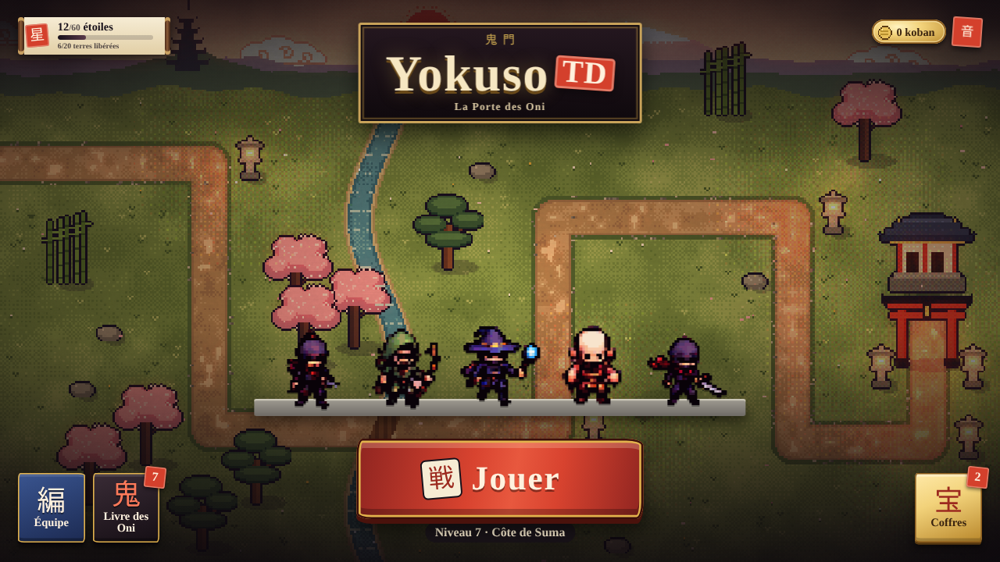
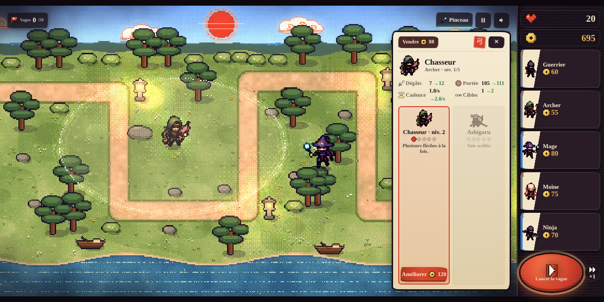
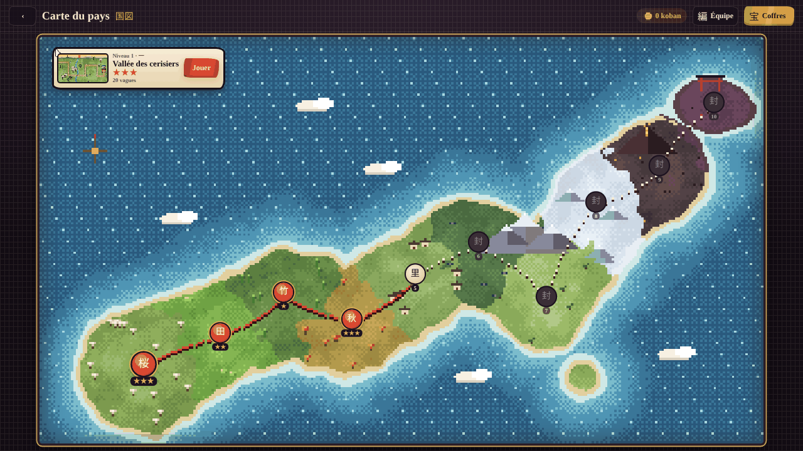
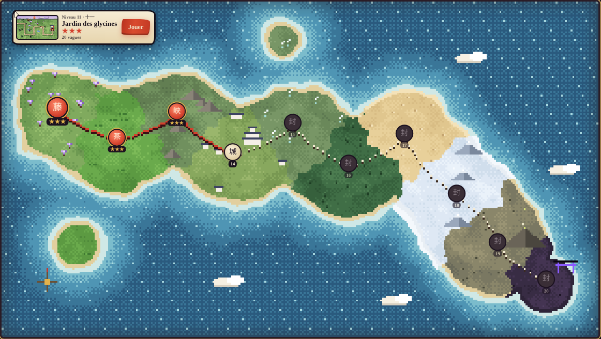
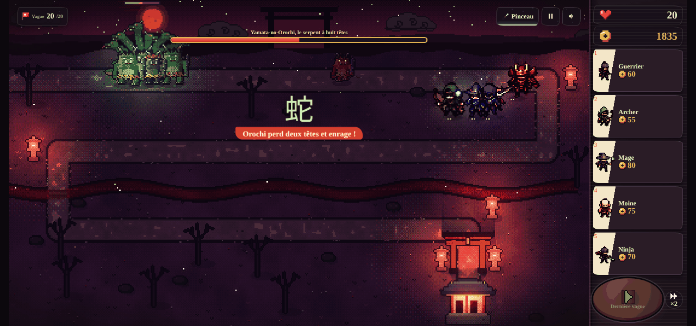
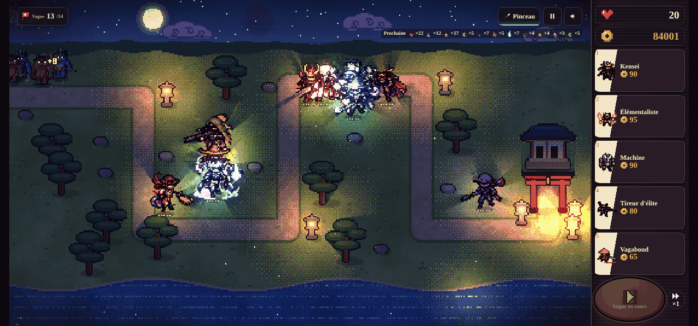
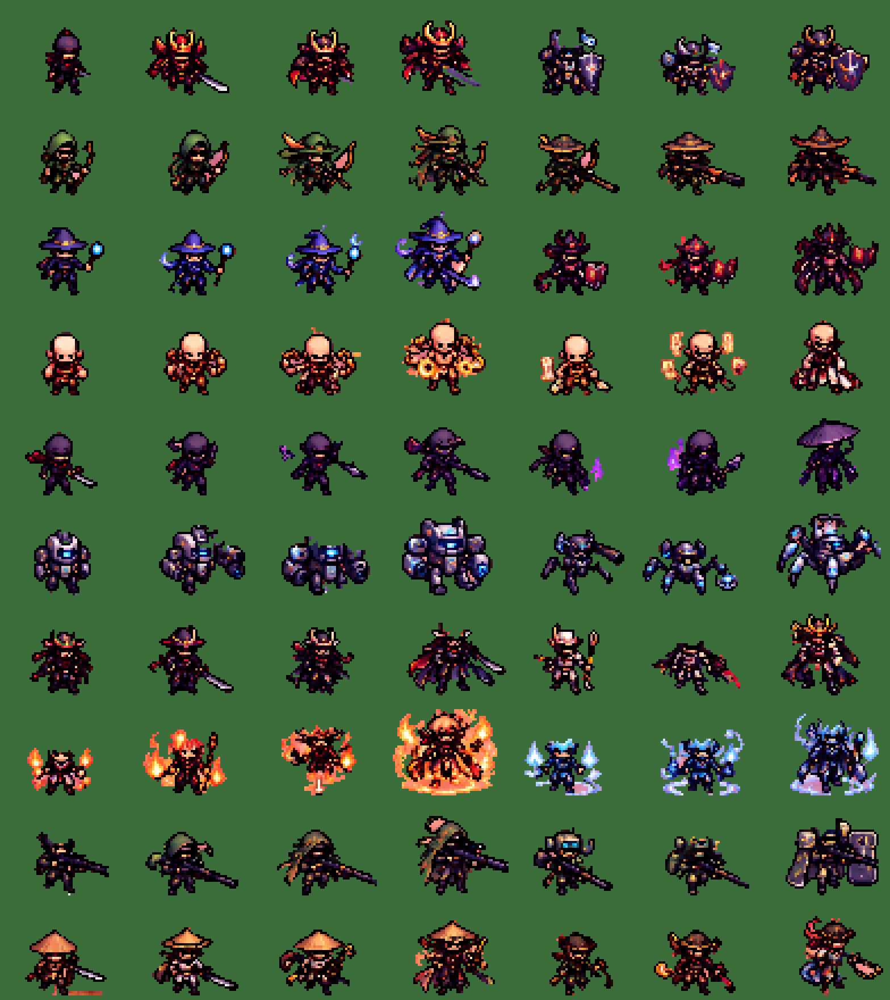
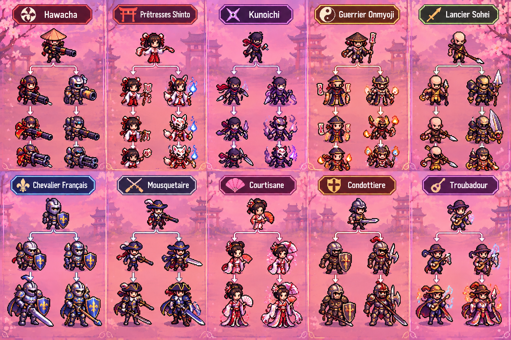
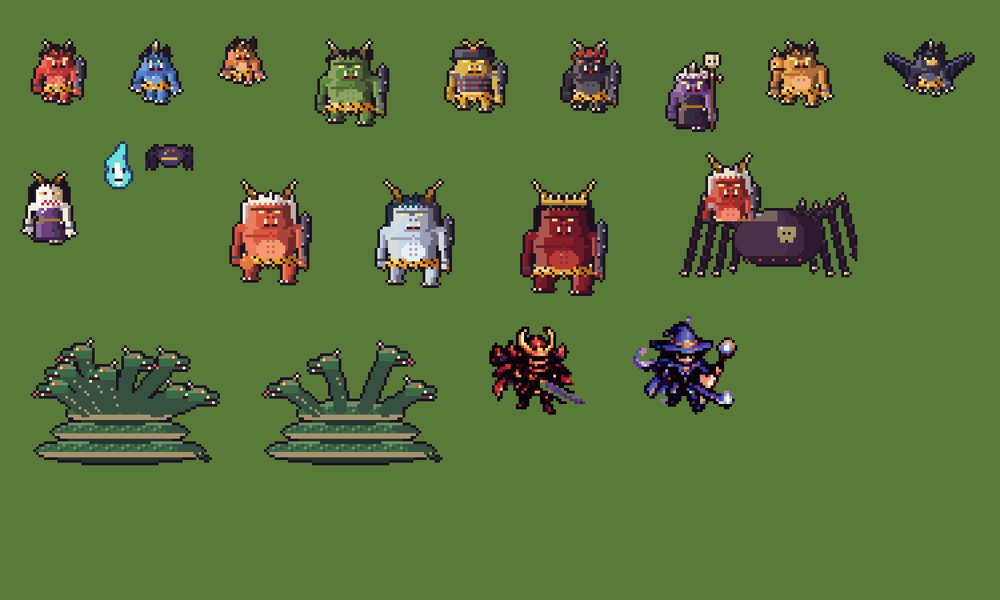

<p align="center"></p>

# YokusoTD · La Porte des Oni

**▶ Jouer dans le navigateur : https://firetaleshy.github.io/YokusoTD/**

Tower defense 2D dans le Japon médiéval. Des hordes d'Oni descendent de la montagne vers les sanctuaires ; tu les arrêtes avec une équipe de cinq héros que tu poses où tu veux sur le champ de bataille. Pixel art inspiré de Celeste, direction artistique sumi-e façon Ōkami, lumières et ombres calculées par shader, en plein jour.

Fonctionne sur ordinateur et sur mobile (en paysage). Rien à installer : un seul fichier, `index.html`.

Nouveautés de la version 1.1 : 10 personnages, une deuxième carte de 10 niveaux, le livre des Oni et un nouveau menu. Le détail est dans le [journal des modifications](CHANGELOG.md).

<p align="center"></p>

<p align="center"></p>

<p align="center"></p>

## Comment jouer

1. Choisis un niveau sur la carte du pays : touche un sceau pour voir sa fiche, retouche-le ou appuie sur « Jouer » pour le lancer. Une fois la Porte des Oni scellée, le bouton « Au-delà » ouvre la deuxième carte.
2. Glisse un personnage depuis la barre de droite et lâche-le sur le terrain. Le cercle montre sa portée ; il devient rouge si l'endroit est interdit (chemin, eau, décor).
3. Lance la vague avec le gros bouton rond. Chaque Oni tué rapporte des pièces.
4. Avant un niveau difficile, ouvre le **Livre des Oni** depuis le menu ou la carte : chaque Oni rencontré y a sa fiche et des conseils pour le battre.
5. Touche un personnage posé pour l'améliorer : au premier niveau, tu choisis une de ses deux voies d'évolution, puis tu la montes jusqu'au niveau 5.
6. Un Oni qui atteint le sanctuaire te coûte des vies (♥). À zéro, c'est perdu.

En cas de coup dur, le **pinceau** ralentit le temps : trace un trait d'encre sur les Oni pour les trancher.

| Touche | Action |
|---|---|
| Glisser une carte, ou `1` à `5` puis clic | Poser un personnage |
| `Espace` | Lancer la vague |
| `U` | Améliorer le personnage sélectionné |
| `B` | Pinceau |
| `F` | Vitesse ×1, ×2, ×3 |
| `P` / `Échap` | Pause |
| `M` | Son |

## Contenu

- **20 personnages**, chacun avec une recrue et 2 voies d'évolution (sprites ci-dessous). Ton équipe en compte 5, à composer dans le menu **Équipe**.
- **20 niveaux de 20 vagues** répartis sur 2 cartes du pays :
  - **Carte du pays** : cerisiers, rizières, bambous, automne, village, marais, côte, montagnes enneigées, volcan, Porte des Oni.
  - **Au-delà de la Porte** (débloquée après la Porte des Oni) : glycines, théiers d'Uji, gorges de Kiso, château de Himeji, sources de Hakone, forêt des kodama, dunes de Tottori, glaces d'Ezo, mont Osore, Yomi.
- **12 types d'Oni** : volants, cuirassés, guérisseurs, spectres qui traversent les attaques, Oni qui se divisent…
- **Boss finaux uniques tous les 5 mondes** : Tsuchigumo, l'araignée des terres (monde 5), qui pond des araignées, Yamata-no-Orochi, le serpent à huit têtes (monde 10), qui perd ses têtes et enrage, Ura, roi des Oni (monde 15), et Sōjōbō, roi des tengu (monde 20), qui vole et appelle des corbeaux.
- **Livre des Oni** : une page par Oni et par boss, avec ses PV, sa vitesse, ses capacités et comment le battre. Les Oni pas encore rencontrés restent en silhouette.
- **Mode infini** après la 20e vague : un boss toutes les 5 vagues, des koban à chaque vague tenue, record par carte.
- **Raretés** : commun, rare, épique, légendaire, visibles par la couleur de fond dans le menu Équipe. Les plus rares sortent moins souvent des coffres.
- **Coffres** en bois, en laque et en or : koban, nouveaux personnages et cartes de rang (+10 % de dégâts chacune). Le premier succès sur un niveau donne un coffre avec un nouveau personnage.
- **Animations d'attaque** précalculées avec [pixelfx](https://github.com/winkidney/pixelfx-godot).
- Progression sauvegardée dans le navigateur.

<p align="center">


</p>

### Personnages

Recrue, puis voie de gauche et voie de droite :

<p align="center"></p>

<p align="center"></p>

| Personnage | Rôle | Voie 1 | Voie 2 |
|---|---|---|---|
| Guerrier | Corps à corps, frappe 2 Oni | Samouraï | Gardien (étourdit) |
| Archer | Longue portée | Chasseur (plusieurs flèches) | Ashigaru (transperce la file) |
| Mage | Dégâts de zone | Mage céleste (ralentit) | Mage de sang (brûlure) |
| Moine | Onde autour de lui | Moine solaire (anneau de feu) | Moine aux ofuda (ralentit) |
| Ninja | Tir rapide | Shinobi (plusieurs cibles) | Ombre (achève les blessés) |
| Machine | Tir rapide | Karakuri lourd (obus) | Araignée mécanique (rayon) |
| Kensei | Corps à corps, critiques | Lame écarlate | Lame céleste (vagues de sabre) |
| Élémentaliste | Feu de zone | Flamme | Givre (gèle) |
| Tireur d'élite | Très longue portée, vise les plus forts | Sniper | Artilleur (mitraille) |
| Vagabond | Corps à corps | Rōnin (critiques) | Lame errante (double coup) |
| Hawacha | Salves de fusées | Hawacha ardent (brûlure) | Hawacha de siège (obus qui perce l'armure) |
| Prêtresse shintō | Ofuda, touche les spectres | Miko du sanctuaire (ralentit) | Kitsune (feux de renard) |
| Kunoichi | Kunaï empoisonnés | Kunoichi écarlate (plusieurs cibles) | Kunoichi au masque (étourdit) |
| Guerrier onmyōji | Sceaux en zone | Maître des sceaux (fige) | Invocateur de shikigami (feu) |
| Lancier sōhei | Corps à corps, longue allonge | Sōhei (transperce la file) | Naginata lourde (étourdit) |
| Chevalier français | Corps à corps, anti-boss | Paladin (×3 contre les boss) | Chevalier à la lance (étourdit) |
| Mousquetaire | Tir lourd, longue portée | Mousquetaire du roi (vise les plus forts) | Bretteur (fentes critiques) |
| Courtisane | Repousse les Oni | Danseuse à l'éventail (repousse la file) | Oiran (ralentit, rapporte des pièces) |
| Condottiere | Corps à corps, butin | Capitaine mercenaire (gros butin) | Lansquenet (hallebarde) |
| Troubadour | Renforce les alliés | Ménestrel (+dégâts) | Barde de guerre (+cadence) |

### Oni et boss

<p align="center"></p>

## Organisation du dépôt

```
index.html              le jeu complet (servi par GitHub Pages)
docs/images/            captures d'écran du README
docs/art/               planches originales des personnages
tools/sprites/          découpe de la planche en sprites de jeu
tools/pixelfx/          précalcul des animations d'attaque
NOTICE.md               crédits tiers
CHANGELOG.md            journal des modifications
```

`tools/README.md` explique comment régénérer les images embarquées.

## Crédits

Animations d'attaque : [pixelfx](https://github.com/patch-gg/pixelfx) par Patch, via [pixelfx-godot](https://github.com/winkidney/pixelfx-godot), licence MIT. Détails dans [NOTICE.md](NOTICE.md).
